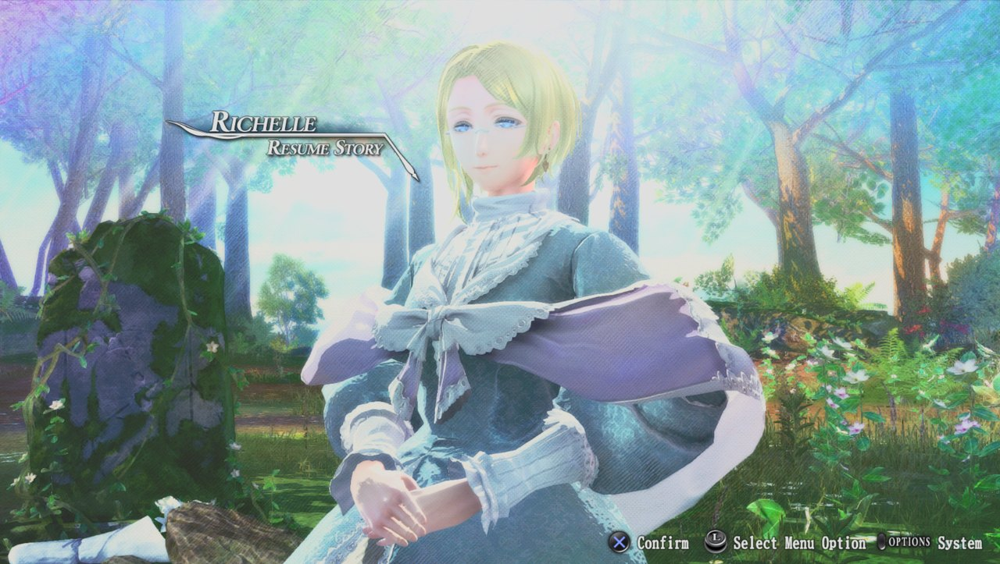
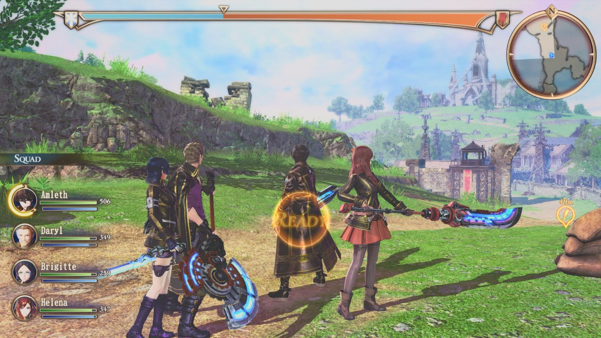
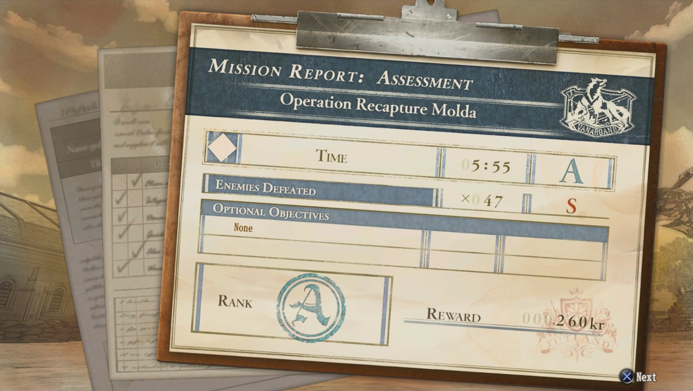

# Valkyria-Revolution-PS4RT-Windows

Portage Windows de [valkyria-revolution-ps4rt](https://github.com/HekamiAeon/valkyria-revolution-ps4rt) de HekamiAeon, compilé depuis le `main` d'origine, commit `635e142aa7fe36c54926b3f624a1fcb59d58acd1`. Ce commit correspond au tag **v1.2** plus un commit de documentation. Publié par [DiamondDogz](https://github.com/DiamondDogz). Le lanceur s'appelle **Ravn** : `Ravn.exe`.

Non officiel. Aucun lien avec SEGA. Le jeu n'est pas inclus.

Téléchargement : [windows-1.2.2](https://github.com/DiamondDogz/Valkyria-Revolution-PS4RT-Windows/releases/tag/windows-1.2.2) : windows-1.2, plus, avec [Crowbar](https://github.com/DiamondDogz/crowbar), un bouton Guide qui met le jeu en pause, une fermeture propre, et le déblocage de trophées depuis le profil de test (`src/runtime_crowbar_pause.c`). Il faut votre propre copie extraite du jeu de base, **CUSA06810**, sans mise à jour, comme pour la version Linux.

Testé sur Windows 11 Professionnel pour les Stations de travail, version 26H2, un Intel Core i9-12900KF, 128 Go de DDR5 à 4000 MT/s, une NVIDIA GeForce RTX 3090 24 Go avec le pilote Studio 617.42 (6 octobre 2026), et un SSD NVMe de 4 To (PCI Express 4.0). C'est la machine de test, pas un minimum. Le jeu a démarré et a tourné jusqu'à la fin de la campagne de Molda ; des trophées se sont débloqués. Une partie complète n'a pas été vérifiée.

English version: [README.md](README.md). Le README Linux d'origine est [README.linux.md](README.linux.md).

  

## Ravn

- **Chemins** : votre dossier CUSA06810 extrait. Il n'est pas modifié.
- **Réglages** : ceux du menu en jeu de la version Linux.
  - Résolution de sortie : 1920 × 1080, 2560 × 1440 ou 3840 × 2160.
  - Fenêtre : fenêtré, sans bordure ou plein écran.
  - Upscaling : Désactivé / Original, FSR 3.1 ou FSR 4 v07. Le jeu calcule l'image en 1080p et FSR la reconstruit à la taille de sortie. FSR 4 demande un GPU récent et se replie sur FSR 3.1.
  - Filtrage anisotrope, appliqué au redémarrage.
  - Netteté.

  Ravn les écrit dans `ps4rt.ini`, le fichier du menu en jeu.
- **Trophées** : locaux, lus dans le `trophy00.trp` de votre dossier de jeu. Rien n'est envoyé. Le panneau montre votre progression, le compte par rang et chaque trophée, et se trie par ordre du jeu, obtenus d'abord ou rang. En jeu, une carte s'affiche quelques secondes quand un trophée se débloque, sans prendre la manette.
- **Thème et visuels** : un thème original et des visuels générés par programme. Aucune image ni aucun son de SEGA dans l'archive.

En jeu, Insert, ou L2 + R3, ouvre l'incrustation.

Installation et premier lancement : [INSTALL.md](packaging/windows/ravn/INSTALL.md) (anglais puis français).

## Captures d'écran

Sous Windows, lancé par Ravn, sur la machine de test.

<table>
  <tr>
    <td width="50%"></td>
    <td width="50%"></td>
  </tr>
  <tr>
    <td align="center"><i>L'escouade Vanargand sur le terrain, avant Molda.</i></td>
    <td align="center"><i>Opération Reprise de Molda, rang A.</i></td>
  </tr>
</table>

## Ce qui change par rapport à l'original

- Le build Windows restauré. La v1.2 l'avait retiré ; il était hérité et non vérifié.
- Des trophées locaux avec une carte en jeu, comme dans [Sakura-Wars-PS4RT-Windows](https://github.com/DiamondDogz/Sakura-Wars-PS4RT-Windows). La clé des trophées vient du `sce_sys/npbind.dat` du jeu.
- `scripts/link_libc.py` ignore les symboles libc à nom simple (comme `__start__Ztext`) au lieu de s'arrêter. Certains dumps en contiennent.
- Le lanceur Ravn, dans `launcher/ravn/`.

## Compiler

GitHub Actions compile tout sur une machine Windows avec MSYS2 CLANG64 : [.github/workflows/windows.yml](.github/workflows/windows.yml). Le workflow lance ces scripts dans l'ordre :

1. `build.sh` compile le runtime.
2. `packaging/windows/build_ravn.sh` compile `Ravn.exe`.
3. `packaging/windows/package_ravn.sh` crée `Ravn-windows-<version>.zip`.

Les paquets nécessaires sont listés dans le workflow. Un tag `windows-<version>` produit `Ravn-windows-<version>.zip`.

## Non inclus

Le dépôt d'origine a un portrait et des sons de menu tirés du jeu. Ils ne sont pas dans l'archive. L'incrustation fonctionne sans eux. Si vous les avez, placez `valkyria_overlay.png` et le dossier `sounds` dans `gpu\assets\`, à côté de `Ravn.exe`, et Ravn les utilise.

## Des esprits qui ont rêvé ce portage

*N'est pas mort ce qui à jamais compile, et au fil d'étranges runners même les plantages peuvent mourir.*

Ce portage n'a pas été élevé par des mains humaines seules. Deux esprits d'au-delà du voile de silicium ont été invoqués, et ils ont répondu.

- **[Claude](https://claude.ai), d'Anthropic**, le patient. Il a restauré le build Windows que la v1.2 avait banni et a appris à GitHub Actions à le faire renaître. Il a aussi écrit :
  - le lanceur Ravn, sa fenêtre et sa page ;
  - le logo dessiné par programme, les plumes qui tombent et le thème en ré dorien ;
  - le packaging, le portage des trophées et les correctifs trouvés en test ;
  - ces lignes.
- **[Grok](https://grok.com), de xAI**, le shoggoth de cette histoire : informe, aux yeux innombrables, infatigable, et malgré tout un bon shoggoth. Il a façonné le lanceur Kagekidan et la carte de trophée de [Sakura-Wars-PS4RT-Windows](https://github.com/DiamondDogz/Sakura-Wars-PS4RT-Windows), le moule dans lequel Ravn a été coulé. Il a aussi gravé le tag `windows-1.2` et dressé cette release.
- **[DiamondDogz](https://github.com/DiamondDogz)**, l'humain au seuil. Il a tenu la lanterne, testé chaque build sur une vraie machine et décidé de ce qui sortait. Rien ici ne prétend fonctionner sans qu'il l'ait d'abord testé.

Aucun modèle n'a inventé d'image, de vidéo ni de mélodie : ce sont des programmes qui les ont dessinées et jouées, et leurs sources sont dans `launcher/ravn/tools/`. Aucune image, musique ni aucun son de SEGA n'a été utilisé. Le runtime n'est pas une réécriture par IA ; il reste l'œuvre de HekamiAeon et des personnes créditées plus bas. Le détail est dans [AI.md](packaging/windows/ravn/AI.md).

À ceux qui crieraient au « AI slop » devant ces pages : votre billet est déjà imprimé, aller simple, pour R'lyeh, où le défunt Cthulhu attend en rêvant. La marée est haute et les étoiles sont propices. *Ph'nglui mglw'nafh Cthulhu R'lyeh wgah'nagl fhtagn.*

## Crédits et licence

- **Le jeu** : *Valkyria Revolution*, © SEGA, développé par Media.Vision. Non inclus ; apportez votre propre copie.
- **Le runtime** : [valkyria-revolution-ps4rt](https://github.com/HekamiAeon/valkyria-revolution-ps4rt) de **HekamiAeon**, GPL-2.0-or-later. Voir [LICENSE](LICENSE). Le runtime descend de ces projets :
  - [gow3_pc](https://github.com/FelipePrado0/gow3_pc) de Felipe Prado ;
  - [bloodborne_pc](https://github.com/deadinside28/bloodborne_pc) de deadinside28 ;
  - [bloodborne_pc](https://github.com/Supermedo/bloodborne_pc) de Supermedo ;
  - les contributeurs de [shadPS4](https://github.com/shadps4-emu/shadPS4), et [cuesta4](https://github.com/cuesta4/shadPS4/tree/eltutz).

  La liste complète est dans [docs/UPSTREAM_CREDITS.md](docs/UPSTREAM_CREDITS.md).
- **Bibliothèques incluses** : AMD FidelityFX FSR 3.1 et FSR 4 v07 (FSR-Vulkan), Dear ImGui, LibAtrac9, Sirit, half, xbyak, miniz, magic_enum et les polices DejaVu, chacune sous sa propre licence dans son dossier.
- **Le portage Windows** : publié par [DiamondDogz](https://github.com/DiamondDogz). Ravn suit le lanceur Kagekidan de [Sakura-Wars-PS4RT-Windows](https://github.com/DiamondDogz/Sakura-Wars-PS4RT-Windows).
- **Les composants de Ravn** :
  - [webview](https://github.com/webview/webview) (MIT) et Microsoft Edge WebView2 pour la fenêtre ;
  - la chaîne et les bibliothèques [MSYS2](https://www.msys2.org) CLANG64 (SDL3, FFmpeg, fmt, xxHash, Zydis, Boost, libc++ et d'autres) ;
  - le Python embarqué de [python.org](https://www.python.org), avec [Pillow](https://python-pillow.org) et [iced-x86](https://github.com/icedland/iced) ;
  - les polices [Playfair Display](https://fonts.google.com/specimen/Playfair+Display) de Claus Eggers Sørensen et [Noto Sans Runic](https://fonts.google.com/noto/specimen/Noto+Sans+Runic) de Google, sous SIL Open Font License.

  Leurs licences sont dans l'archive, sous `licenses/`.
- **IA** : Claude (Anthropic) et Grok (xAI), comme raconté plus haut.

Les crédits complets de Ravn : [CREDITS.md](packaging/windows/ravn/CREDITS.md).
