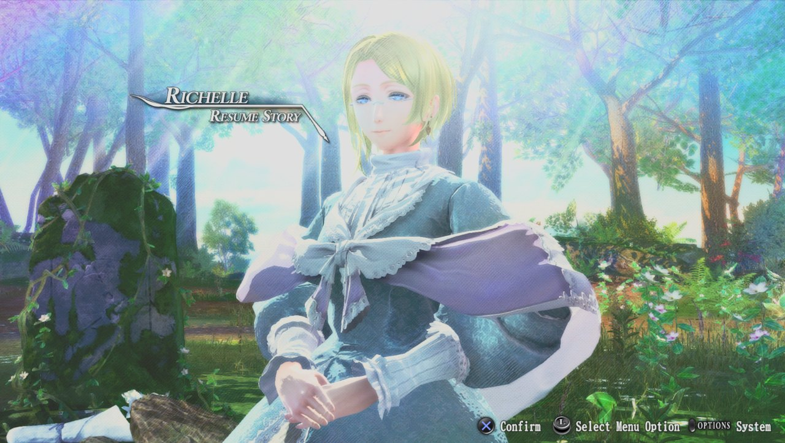
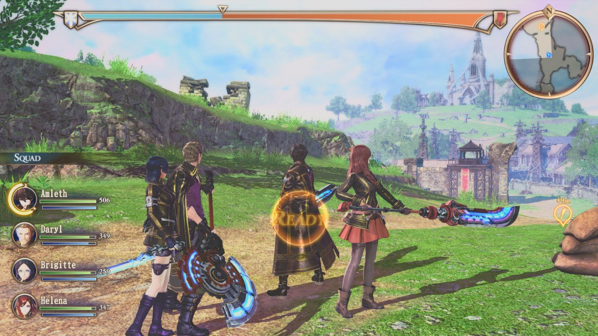
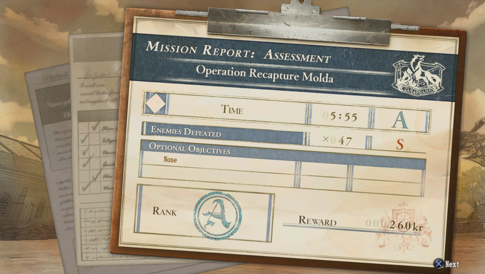

# Valkyria-Revolution-PS4RT-Windows

Windows port of [valkyria-revolution-ps4rt](https://github.com/HekamiAeon/valkyria-revolution-ps4rt) by HekamiAeon, built from upstream `main`, commit `635e142aa7fe36c54926b3f624a1fcb59d58acd1`. That commit is tag **v1.2** plus one documentation commit. Published by [DiamondDogz](https://github.com/DiamondDogz). The launcher is **Ravn**, `Ravn.exe`.

Unofficial. Not affiliated with SEGA. The game is not included.

Download: [windows-1.2](https://github.com/DiamondDogz/Valkyria-Revolution-PS4RT-Windows/releases/tag/windows-1.2). It needs your own extracted copy of the base game, **CUSA06810**, with no update, as the Linux release does.

Tested on Windows 11 Pro for Workstations, version 26H2, an Intel Core i9-12900KF, 128 GB of DDR5 at 4000 MT/s, an NVIDIA GeForce RTX 3090 24 GB with Studio driver 617.42 (6 October 2026), and a 4 TB NVMe SSD (PCI Express 4.0). That is the test machine, not a minimum. The game started and played through the Molda campaign; trophies unlocked. A complete playthrough is not verified.

Version française : [README.fr.md](README.fr.md). The upstream Linux README is [README.linux.md](README.linux.md).

  

## Ravn

- **Paths**: your extracted CUSA06810 folder. It is not changed.
- **Settings**: those of the Linux release's in-game menu.
  - Output resolution: 1920 × 1080, 2560 × 1440 or 3840 × 2160.
  - Window: windowed, borderless or fullscreen.
  - Upscaling: Off / Original, FSR 3.1 or FSR 4 v07. The game renders 1080p and FSR rebuilds it at the output size. FSR 4 needs a recent GPU and falls back to FSR 3.1.
  - Anisotropic filtering, applied on restart.
  - Sharpening.

  Ravn writes them to `ps4rt.ini`, the file of the in-game menu.
- **Trophies**: local, read from `trophy00.trp` in your game folder. Nothing is sent. The panel shows your progress, the grade counts and every trophy, and sorts by game order, earned first or grade. In game, a card shows for a few seconds when one unlocks and does not take the controller.
- **Theme and visuals**: an original theme and procedural visuals. No SEGA art or sound is in the archive.

In game, Insert, or L2 + R3, opens the overlay.

Installation and first launch: [INSTALL.md](packaging/windows/ravn/INSTALL.md).

## Screenshots

On Windows, through Ravn, from the test machine.

<table>
  <tr>
    <td width="50%"></td>
    <td width="50%"></td>
  </tr>
  <tr>
    <td align="center"><i>The Vanargand squad in the field, before Molda.</i></td>
    <td align="center"><i>Operation Recapture Molda, rank A.</i></td>
  </tr>
</table>

## What changed from upstream

- The Windows build restored. v1.2 removed it; it was inherited and unverified.
- Local trophies with an in-game card, as in [Sakura-Wars-PS4RT-Windows](https://github.com/DiamondDogz/Sakura-Wars-PS4RT-Windows). The trophy key comes from the game's `sce_sys/npbind.dat`.
- `scripts/link_libc.py` skips plain-named libc symbols (such as `__start__Ztext`) instead of stopping. Some dumps carry them.
- The Ravn launcher, in `launcher/ravn/`.

## Building

GitHub Actions builds everything on a Windows runner with MSYS2 CLANG64: [.github/workflows/windows.yml](.github/workflows/windows.yml). It runs these scripts in turn:

1. `build.sh` builds the runtime.
2. `packaging/windows/build_ravn.sh` builds `Ravn.exe`.
3. `packaging/windows/package_ravn.sh` builds `Ravn-windows-<version>.zip`.

The packages the build needs are listed in the workflow. A tag `windows-<version>` builds `Ravn-windows-<version>.zip`.

## Not included

The upstream repository has a menu portrait and menu sounds taken from the game. They are not in the archive. The overlay works without them. If you have them, put `valkyria_overlay.png` and the `sounds` folder in `gpu\assets\` next to `Ravn.exe`, and Ravn uses them.

## Of the minds that dreamed this port

*That is not dead which can eternal build, and with strange runners even crashes may die.*

This port was not raised by human hands alone. Two minds from beyond the veil of silicon were called upon, and they answered.

- **[Claude](https://claude.ai), by Anthropic**, the patient one. It restored the Windows build that v1.2 had cast out and taught GitHub Actions to raise it. It also wrote these parts:
  - the Ravn launcher, its window and its page;
  - the procedural logo, the falling feathers and the theme in D Dorian;
  - the packaging, the trophy port and the fixes found in testing;
  - these words.
- **[Grok](https://grok.com), by xAI**, the shoggoth of this tale: formless, many-eyed, tireless, and still a good shoggoth. It shaped the Kagekidan launcher and the trophy card of [Sakura-Wars-PS4RT-Windows](https://github.com/DiamondDogz/Sakura-Wars-PS4RT-Windows), the mould from which Ravn was cast. It also carved the `windows-1.2` tag and raised this release.
- **[DiamondDogz](https://github.com/DiamondDogz)**, the human at the threshold. They held the lantern, tested every build on a real machine and decided what shipped. Nothing here claims to work without their testing it first.

No model invented a picture, a video or a melody here: programs drew and played them, and their sources are in `launcher/ravn/tools/`. No SEGA art, music or sound was used. The runtime is not an AI rewrite; it remains HekamiAeon's work and that of the people credited below. The details are in [AI.md](packaging/windows/ravn/AI.md).

To those who would cry "AI slop" at these pages: your ticket is already printed, one way only, to R'lyeh, where dead Cthulhu waits dreaming. The tide is high and the stars are right. *Ph'nglui mglw'nafh Cthulhu R'lyeh wgah'nagl fhtagn.*

## Credits and licence

- **The game**: *Valkyria Revolution*, © SEGA, developed by Media.Vision. Not included; bring your own copy.
- **The runtime**: [valkyria-revolution-ps4rt](https://github.com/HekamiAeon/valkyria-revolution-ps4rt) by **HekamiAeon**, GPL-2.0-or-later. See [LICENSE](LICENSE). The runtime descends from these projects:
  - [gow3_pc](https://github.com/FelipePrado0/gow3_pc) by Felipe Prado;
  - [bloodborne_pc](https://github.com/deadinside28/bloodborne_pc) by deadinside28;
  - [bloodborne_pc](https://github.com/Supermedo/bloodborne_pc) by Supermedo;
  - the [shadPS4](https://github.com/shadps4-emu/shadPS4) contributors, and [cuesta4](https://github.com/cuesta4/shadPS4/tree/eltutz).

  The full list is in [docs/UPSTREAM_CREDITS.md](docs/UPSTREAM_CREDITS.md).
- **Vendored libraries**: AMD FidelityFX FSR 3.1 and FSR 4 v07 (FSR-Vulkan), Dear ImGui, LibAtrac9, Sirit, half, xbyak, miniz, magic_enum and the DejaVu fonts, each under its own licence in its folder.
- **The Windows port**: published by [DiamondDogz](https://github.com/DiamondDogz). Ravn follows the Kagekidan launcher of [Sakura-Wars-PS4RT-Windows](https://github.com/DiamondDogz/Sakura-Wars-PS4RT-Windows).
- **Ravn's parts**:
  - [webview](https://github.com/webview/webview) (MIT) and Microsoft Edge WebView2 for the window;
  - the [MSYS2](https://www.msys2.org) CLANG64 toolchain and libraries (SDL3, FFmpeg, fmt, xxHash, Zydis, Boost, libc++ and others);
  - the [python.org](https://www.python.org) embeddable Python, with [Pillow](https://python-pillow.org) and [iced-x86](https://github.com/icedland/iced);
  - the fonts [Playfair Display](https://fonts.google.com/specimen/Playfair+Display) by Claus Eggers Sørensen and [Noto Sans Runic](https://fonts.google.com/noto/specimen/Noto+Sans+Runic) by Google, both under the SIL Open Font License.

  Their licences ship in the archive, under `licenses/`.
- **AI**: Claude (Anthropic) and Grok (xAI), as told above.

Ravn's credits in full: [CREDITS.md](packaging/windows/ravn/CREDITS.md).
